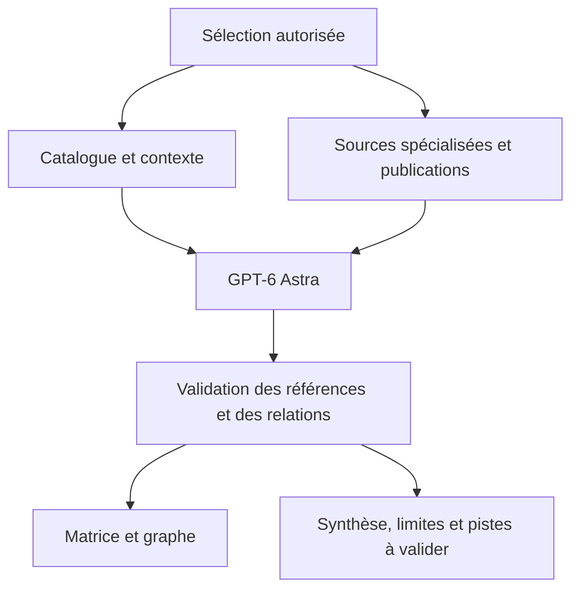

# Restauration du moteur de recherche médical avec Astra

## Références et périmètre

Comparaison de `13a723d735b4676257d61eb16dff3209a38a96a2` (16 juin 2026) avec `930c101967997022520205e80cc0e1f2a5bcb991` (5 novembre, PR #38). L’historique principal ne contient aucun commit en juillet–août : la référence de juin est donc la dernière base Git disponible pour cette période. Cela ne constitue pas une vérification rétrospective des déploiements exécutés à ces dates.

Le projet vérifié est `mtnrconcept/medimind-nexus`, Supabase **Medicore** `kparxcfspgoonqttduyk`, Vercel `medimind-nexus`. La production observée au début du travail correspond au commit `930c101…`, état READY. Cette note décrit une modification candidate ; elle ne signifie pas que ces changements sont déjà en production.

## Diagnostic historique

| Domaine | Régression ou limite constatée | Décision |
| --- | --- | --- |
| Contexte de l’analyse croisée | La matrice introduite le 2 novembre réduisait les colonnes du catalogue. Le nouvel agent du 5 novembre recevait les concepts sélectionnés, mais perdait les descriptions et associations locales. | Reconstruire les fiches canoniques côté serveur et les conserver dans le travail. Les transmettre aux paires, au plan et à la revue finale. |
| Bibliographie | La persistance réduisait les références de matrice à leur titre et URL. | Conserver résumé, PMID, fournisseur, revue, année, type de publication, requête et limites. Les rendre consultables. |
| Graphe | Le contexte des concepts était réduit aux noms ; le rendu pouvait fusionner plusieurs relations ou leurs directions et perdre leur justification. | Conserver des identifiants par groupe, des relations directionnelles typées, leurs justifications et les références. |
| Comorbidité et expansion | Les recherches séparées par pathologie limitaient l’analyse des relations traversant plusieurs groupes. Des arêtes étaient tronquées à 100 dans une analyse détaillée. | Fournir le contexte commun et les relations pertinentes, avec limites de capacité explicites. |
| Chat du graphe | Le client limitait certaines commandes à 50 arêtes ; le serveur utilisait essentiellement leur nombre et ignorait justifications, références et limites. | Transmettre les relations et leurs preuves dans un contexte structuré, borné, avec un bilan des éléments omis. |
| Routage des modèles | Des outils demandaient encore `gpt-5.5`, puis héritaient d’un modèle clinique générique selon le vocabulaire du prompt. Une recherche ordinaire pouvait donc utiliser Sol. | Contrat de recherche explicite `gpt-6-astra`, sans supprimer l’évaluation de risque ni les exigences de preuve. |
| Durée du graphe | Un appel direct devait terminer dans le budget de la fonction Edge. | Collecte, création de réponse et finalisation exécutées dans des workers distincts, avec suivi durable. |

Les sources et prompts de plusieurs autres outils — recherche systématique, ciblée, focused, live, découverte et génération d’hypothèses — n’avaient pas été supprimés depuis juin. Le correctif conserve ces mécanismes et rend leur modèle effectif cohérent. Il ne réintroduit pas les anciens quotas arbitraires de nœuds ni les liens thérapeutiques inférés depuis une simple correspondance de texte.

Le composant appelé « radial graph 3D » rend déjà sa vue principale en SVG depuis la référence historique. Cette restauration concerne son moteur, ses données et ses interactions ; elle ne prétend pas avoir changé ce rendu en une nouvelle scène 3D.

## Contrat restauré

Le contexte du catalogue reste étiqueté `unverified_context`. Les codes CIM, formulations, indications documentaires, effets indésirables ou associations locales servent à rechercher et désambiguïser. Ils ne deviennent pas automatiquement une preuve d’efficacité, de causalité ou d’innocuité. Les champs absents restent inconnus. Les bornes de contexte indiquent les champs ou listes abrégés.

L’agent croisé conserve la couverture de toutes les paires sélectionnées, dans les deux sens, et la vérification des candidats avant la revue finale. Les données individuelles d’un patient ou d’une cohorte ne sont pas ajoutées aux recherches de concepts publics. Les anciens travaux demeurent lisibles ; une nouvelle analyse est nécessaire pour profiter du contexte restauré.

Le graphe conserve les relations de types ou directions différents entre les mêmes concepts. Les références proposées par le modèle ne sont retenues que si elles correspondent aux sources effectivement récupérées ou à sa trace de recherche native. Une référence liée ne devient pas un grade de preuve élevé. Les sources indisponibles, résumés abrégés, limites de taille et questions non résolues restent visibles.

Le contrat Astra est appliqué aux 24 autres fonctions de synthèse recensées, ainsi qu’aux branches historiques de l’analyse croisée encore accessibles. Les réponses déjà créées avec un ancien modèle restent finalisables avec leur modèle réel ; leur reprise ne déclenche pas une nouvelle génération. Les étapes de traduction ou d’extraction conservent leur rôle distinct.

Le chat du graphe reçoit les descriptions, relations directionnelles, justifications, références bibliographiques et limites. Son budget de contexte est de 200 000 caractères JSON ; les raccourcis et omissions sont comptés et affichés. Une référence fournie par le navigateur reste explicitement non vérifiée dans cet échange.

## Exécution et reprise du graphe

Le nouveau chemin `async:true` utilise la table existante `ai_analysis_jobs`, en mode `graph_research`, avec expiration à 24 heures. L’admission vérifie la session, reconstruit les paramètres autorisés, et associe une référence UUID stable à leur empreinte. La contrainte unique de `public_token` arbitre les requêtes concurrentes et la perte d’un accusé de réception. Une référence réutilisée pour un autre contenu est rejetée.

Le premier worker collecte et enregistre le contexte. Le suivant crée une réponse OpenAI en arrière-plan. Le moniteur conserve l’identifiant fournisseur et le worker de finalisation relit cette même réponse, avec sa provenance. Une panne de sauvegarde finale ne crée pas de nouvelle génération. Les lectures et écritures des workers sont protégées par les baux du moniteur existant.

Les clients antérieurs conservent le contrat synchrone JSON/SSE. Les nouvelles interfaces utilisent l’admission persistante et la reprise par référence. Aucun secret, prompt ou résultat n’est ajouté au stockage local du navigateur.

Les requêtes natives sont liées au compte vérifié, avec son JWT transmis explicitement et des contrôles avant/après chaque invocation. Un changement de compte détache l’observation et efface la vue concernée. Les modes local et cloud utilisent des périmètres de reprise distincts. Une lecture dédiée ne confirme l’expiration que pour le propriétaire et les paramètres exacts du travail, sans insertion ni lancement de moniteur.

Deux fonctions de synthèse historiques lisaient des données patients avec le rôle de service. `pathology-analyzer` utilise désormais une session vérifiée et les RLS du demandeur. `detect-side-effects` vérifie aussi le droit d’écriture via la RPC existante `has_patient_access`, car il crée des alertes ; ses lectures et insertions utilisent le client utilisateur. La présence de la RPC, ses droits d’exécution et les policies de `side_effect_alerts` ont été vérifiés en lecture seule sur le projet actif. Aucun schéma ni droit n’est modifié.

## Bornes et limites

- Le graphe accepte jusqu’à 12 pathologies, 150 nouveaux nœuds et 500 concepts de contexte ; les limites sont validées explicitement.
- Les collectes réseau restent bornées. Une source lente ou indisponible produit un état partiel, pas une conclusion négative.
- Les anciennes synthèses génériques restent soumises au budget existant du transport, environ 130 secondes. La restauration ne garantit pas une durée illimitée pour chaque outil historique.
- Le budget de sortie comprend le raisonnement du modèle. Le contrat Astra conserve les budgets élevés existants, applique les bornes communes et garde le raisonnement renforcé des situations critiques.
- Les tests vérifient les contrats logiciels, la provenance, la reprise et les contrôles d’accès. Ils ne mesurent pas l’exactitude médicale générale et ne valident pas un traitement individuel.

## Déploiement et retour arrière

Aucune migration ni nouvelle variable d’environnement n’est requise. Vérifier les fonctions utilisant le contrat partagé, puis déployer les fonctions serveur modifiées avant le frontend qui emploie la nouvelle admission du graphe. Les fonctions du graphe, de l’analyse croisée et du transport doivent utiliser les mêmes contrats que le frontend.

Conserver les anciennes actions et les données des travaux. Pour revenir en arrière, rétablir le frontend et les fonctions depuis la référence précédente, sans supprimer les tables ni les résultats. Éviter de remplacer le worker du graphe tant que des travaux `graph_research` sont en cours : conserver sa compatibilité le temps de leur finalisation.

## Vérification de la version candidate

Contrôles locaux exécutés sur la version candidate :

| Contrôle | Résultat |
| --- | --- |
| `node --import tsx --test --test-concurrency=1 tests/*.test.ts` | 544 tests réussis, aucun échec ni test ignoré. |
| `npm run typecheck`, `typecheck:microsignals`, `typecheck:patient-matching`, `typecheck:workspace` | Réussis. |
| `npx tsc -p tsconfig.ai-continuity.json --pretty false` | Réussi. |
| `npx tsc -p tsconfig.scientific-library.json --pretty false` | Réussi. |
| `npx tsc -p tsconfig.anatomical-twin.json --pretty false` | Réussi. |
| `npx tsc -p tsconfig.graph-research.json --pretty false` | Réussi, avec le vrai composant Radial et les tests de session/reprise, sans faux types. |
| `npm run lint` | Zéro erreur ; 1 085 avertissements restent présents dans le dépôt. |
| `npm run build` | Réussi ; le bundler signale toujours des fichiers de sortie volumineux. |
| `npm run check:signal-edge` | Réussi. |
| `node scripts/audit-production.mjs` | Gate réussi : 0 vulnérabilité critique ; 19 hautes et 4 modérées signalées dans les dépendances existantes. |
| `git diff --check` | Réussi. |

Les cas de régression couvrent la transmission réelle du contexte aux requêtes de synthèse, les références non inventées, les directions et types de relations, les métadonnées bibliographiques, les réponses historiques, la reprise après interruption, les doubles soumissions, les changements de compte et les accès de deux utilisateurs à des patients distincts. Les fournisseurs et données cliniques de ces tests sont synthétiques.

Le contrôle Deno local n’a pas pu télécharger `esm.sh` et `deno.land` : la connexion est refusée dans l’environnement d’exécution. La CI de la [PR #39](https://github.com/mtnrconcept/medimind-nexus/pull/39) vérifie 29 points d’entrée Edge, en plus des tests, du build et des assertions PostgreSQL 17. Le premier passage distant a confirmé les tests et les assertions PostgreSQL, puis identifié une incompatibilité de type générique dans l’adaptateur Supabase du graphe. L’adaptateur utilise désormais le type `SupabaseClient` explicite ; la PR expose le résultat des contrôles sur chaque révision.

L’aperçu Vercel du premier commit a atteint l’état READY et son accueil a été ouvert dans un navigateur distant. Aucune erreur de chargement de l’application n’a été observée. Le parcours authentifié n’a pas été exercé. Les composants bibliographiques ont été vérifiés par rendu et assertions, et les interfaces par TypeScript et compilation. Aucune mesure comparative avec des appels réels à Astra ni validation de pertinence médicale n’est revendiquée.

## Inventaire des fichiers modifiés

72 fichiers de la version candidate :

### Interface et continuité du graphe

- `src/components/cde/RadialRingsModal.tsx`
- `src/components/patient/CrossDataAnalyzer.tsx`
- `src/components/patient/RelationshipMatrix.tsx`
- `src/components/patient/ResearchSourceList.tsx`
- `src/lib/aiTransport.ts`
- `src/lib/graphResearch.ts`
- `src/lib/graphResearchSession.ts`
- `src/lib/research-engine-config.json`
- `src/types/graph.ts`
- `src/utils/graphUtils.ts`

### Fonctions et contrats serveur

- `supabase/functions/_shared/ai-tool-registry.ts`
- `supabase/functions/_shared/clinical-brain.ts`
- `supabase/functions/_shared/hypothesis-jobs.ts`
- `supabase/functions/_shared/research-model.ts`
- `supabase/functions/adversarial-reviewer/index.ts`
- `supabase/functions/ai-assistant/index.ts`
- `supabase/functions/analyze-kg-links/index.ts`
- `supabase/functions/analyze-user-links/index.ts`
- `supabase/functions/causal-reasoning/index.ts`
- `supabase/functions/cde-analyze/index.ts`
- `supabase/functions/cross-data-analyzer/agent-contract.ts`
- `supabase/functions/cross-data-analyzer/agent-orchestrator.ts`
- `supabase/functions/cross-data-analyzer/analysis-utils.ts`
- `supabase/functions/cross-data-analyzer/clinical-context.ts`
- `supabase/functions/cross-data-analyzer/index.ts`
- `supabase/functions/cross-data-analyzer/matrix-job.ts`
- `supabase/functions/cross-data-analyzer/pubmed-research.ts`
- `supabase/functions/deep-research-graph/admission.ts`
- `supabase/functions/deep-research-graph/handler.ts`
- `supabase/functions/deep-research-graph/index.ts`
- `supabase/functions/deep-research-graph/jobs.ts`
- `supabase/functions/deep-research-graph/sources.ts`
- `supabase/functions/deep-research/index.ts`
- `supabase/functions/detect-side-effects/index.ts`
- `supabase/functions/discovery-engine/index.ts`
- `supabase/functions/discovery-platform/index.ts`
- `supabase/functions/discovery-search/index.ts`
- `supabase/functions/focused-research/index.ts`
- `supabase/functions/graph-chat/context.ts`
- `supabase/functions/graph-chat/index.ts`
- `supabase/functions/hypothesis-generator/index.ts`
- `supabase/functions/hypothesis-processor/index.ts`
- `supabase/functions/lbd-contradiction-detector/index.ts`
- `supabase/functions/live-research/index.ts`
- `supabase/functions/pathology-analyzer/index.ts`
- `supabase/functions/patient-health-synthesis/index.ts`
- `supabase/functions/radial-rings-engine/index.ts`
- `supabase/functions/scientific-analysis/index.ts`
- `supabase/functions/systematic-research/index.ts`
- `supabase/functions/targeted-research/index.ts`
- `supabase/functions/validate-hypothesis/index.ts`

### Tests de régression

- `tests/ai-transport.test.ts`
- `tests/astra-cross-worker.test.ts`
- `tests/causal-reasoning-routing.test.ts`
- `tests/cross-canonical-context.test.ts`
- `tests/cross-graph-integration.test.ts`
- `tests/cross-matrix.test.ts`
- `tests/graph-chat-evidence.test.ts`
- `tests/graph-research-admission.test.ts`
- `tests/graph-research-client.test.ts`
- `tests/graph-research-jobs.test.ts`
- `tests/graph-research-session.test.ts`
- `tests/hypothesis-jobs.test.ts`
- `tests/radial-research-restoration.test.ts`
- `tests/radial-source-depth.test.ts`
- `tests/research-model-callers.test.ts`
- `tests/research-model.test.ts`
- `tests/research-patient-authorization.test.ts`
- `tests/research-source-display.test.ts`

### Contrôles et documentation

- `.github/workflows/ci.yml`
- `docs/research-restoration-20261105.md`
- `tsconfig.graph-research.json`
